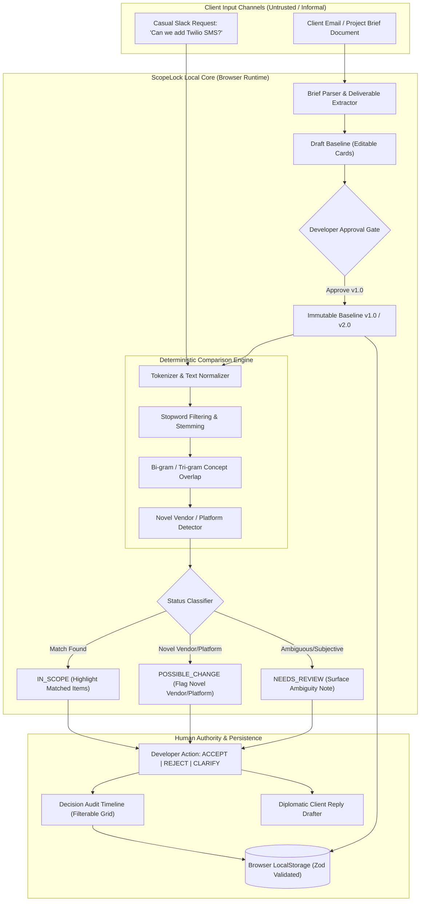
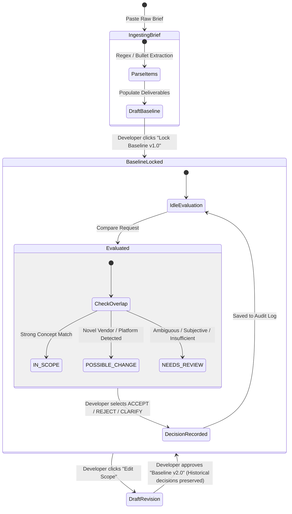

# ScopeLock v1
**Deterministic Scope Creep Protection for Freelance Developers & Software Teams**

> *"Clients handle ambition. Freelancers handle execution. Deterministic baselines handle boundary authority."*
>
> Freelance software developers lose thousands of dollars each project to casual scope creep—novel third-party vendors, mobile companion apps, and extra API integrations smuggled into informal email threads and Slack chats. ScopeLock decouples client requests from uncontrolled expansion: client briefs freeze into versioned mathematical deliverables, follow-up requests are evaluated against approved scope with zero LLM hallucination, and every change is flagged before unbilled work starts.

[](https://nextjs.org)
[](https://www.typescriptlang.org)
[](https://tailwindcss.com)
[](https://zod.dev)
[](tests/)
[](#11-security-model-privacy--limitations)
[](LICENSE)

---

## Table of Contents

1. [The Problem](#1-the-problem)
2. [The Solution](#2-the-solution)
3. [System Architecture & State Machine](#3-system-architecture--state-machine)
4. [Authority Boundaries: Natural Language vs. Deterministic Code](#4-authority-boundaries-natural-language-vs-deterministic-code)
5. [The Deterministic Comparison Engine](#5-the-deterministic-comparison-engine)
6. [The 12 Synthetic Kill-Test Cases](#6-the-12-synthetic-kill-test-cases)
7. [Empirical Verification & Test Coverage](#7-empirical-verification--test-coverage)
8. [Interactive Web Dashboard & Workflow](#8-interactive-web-dashboard--workflow)
9. [Data Model & Storage Schema (Zod)](#9-data-model--storage-schema-zod)
10. [Local Development Setup](#10-local-development-setup)
11. [Security Model, Privacy & Limitations](#11-security-model-privacy--limitations)
12. [Hackathon Artifacts & Submission Roadmap](#12-hackathon-roadmap)
13. [License](#license)

---

## 1. The Problem

Independent software contractors and small digital agencies face a costly, repetitive dilemma when managing client requests:

1. **Agreements Scatter Across Unstructured Channels:** The original statement of work lives across fragmented email threads, kickoff meeting notes, and informal chat channels. There is rarely an explicit, single source of truth for what was actually priced and agreed upon.
2. **"Small Additions" Accumulate into Unbilled Scope Creep:** Clients casually append requests mid-sprint (*"Can we also send SMS receipts via Twilio?"*, *"Can you build a mobile companion app?"*, or *"Can we add multi-currency conversion?"*). Without objective comparison, developers absorb hours of uncompensated labor to avoid confrontation.
3. **LLM Hallucinations Cannot Settle Scope Disputes:** Generic LLM chatbots produce probabilistic, shifting answers when asked whether a feature is "in scope," offering zero audit trail, zero mathematical repeatability, and exposing confidential client briefs to third-party cloud APIs.

---

## 2. The Solution

ScopeLock enforces scope boundaries **locally and deterministically** within the developer's browser:

* **Scope Anchor & Baseline Versioning:** Turn unstructured client emails into numbered, editable deliverable cards. Lock baseline versions (`v1.0`, `v2.0`) with explicit timestamps so expectations never shift silently.
* **Deterministic Mathematical Comparison:** Evaluates incoming client requests against approved deliverables using tokenization, stopword removal, bi-gram/tri-gram overlap, and novel vendor/platform radar (Twilio, iOS/Android, Stripe Forex). Zero LLM hallucinations.
* **Three Strict Status Semantics:**
  * <span style="color:#059669; font-weight:bold;">IN_SCOPE</span>: Demonstrates strong token and concept overlap with an approved deliverable.
  * <span style="color:#ea580c; font-weight:bold;">POSSIBLE_CHANGE</span>: Detects novel third-party vendors, unagreed platforms, or out-of-bounds capabilities requiring a Change Order.
  * <span style="color:#d97706; font-weight:bold;">NEEDS_REVIEW</span>: Surfaces ambiguity, subjective phrasing, or insufficient evidence, prompting developer clarification.
* **Human Authority & Decision Audit Trail:** Developers retain 100% authority to `ACCEPT`, `REJECT`, or `CLARIFY` each request. Every decision is recorded into a persistent, filterable audit log.
* **1-Click Diplomatic Client Reply Drafter:** Instantly generates professional, non-confrontational client reply templates (Change Order proposal, Phase 2 deferral, or technical clarification) ready to paste into Slack or email.
* **Account-Gated Portal Protection:** All client deliverables, comparisons, and decision records are strictly session-gated. Logging out immediately terminates the portal view, safeguarding client confidentiality on shared screens.

---

## 3. System Architecture & State Machine

### System Architecture Flowchart



### Baseline Evolution & Decision State Machine



---

## 4. Authority Boundaries: Natural Language vs. Deterministic Code

| Responsibility | Handled By | Guarantees & Constraints |
|:---|:---|:---|
| **Brief Ingestion & Text Parsing** | Regex & Rule Parser (`briefParser.ts`) | Extracts numbered items, bullet points, and paragraphs; developer reviews before locking. |
| **Input Sanitization & Schema Safety** | Zod Schema Validator (`schemas.ts`) | Strict validation on every read/write to `localStorage`; handles malformed data defensively without crashing. |
| **Scope Comparison & Classification** | Deterministic Comparator (`deterministic.ts`) | Strict mathematical token and n-gram overlap; zero probabilistic hallucination; reproducible test results. |
| **Novel Capability & Platform Radar** | Vendor & Platform Heuristics | Flags unagreed vendors (Twilio, Stripe Forex) and platforms (iOS/Android) outside baseline bounds. |
| **Decision Authority & Scope Action** | Human Developer | Developer retains final authority to Accept, Reject, or Clarify; system provides evidence, not dictate. |
| **Diplomatic Client Communication** | Client Reply Drafter (`ClientResponseModal.tsx`) | Generates ready-to-copy Slack/email templates calibrated to Change Orders, Deferrals, or Clarifications. |
| **Portal Access & Session Security** | Account-Gated Lifecycle (`page.tsx`) | Portal view immediately closes on logout; all transient evaluations purged; deliverables protected from shoulder surfing. |

> **Operating Rule:** *Natural language expresses requirements; deterministic mathematical baselines govern boundary authority.*

---

## 5. The Deterministic Comparison Engine

Rather than delegating scope validation to black-box external AI APIs, ScopeLock's comparison engine is **100% deterministic, transparent, and reproducible**:

1. **Normalization & Tokenization:** Lowercases text, strips punctuation, removes standard English stopwords, and extracts word stems.
2. **N-Gram Concept Overlap:** Computes token and bi-gram Jaccard overlap against each deliverable title, description, and acceptance criteria.
3. **Novel Entity & Platform Radar:**
   * **Telephony / SMS:** Twilio, SendGrid, SMS, WhatsApp, Voice
   * **Mobile Platforms:** iOS, Android, Flutter, React Native, App Store
   * **Payment & Forex:** Multi-currency, Forex, Cryptocurrency, Web3
   * **Exports & Analytics:** PDF export, Excel, BI dashboards, Data pipelines
4. **Transparent Rationale & Uncertainty Scoring:** Outputs a human-readable explanation connecting the decision directly to specific baseline items, accompanied by an explicit uncertainty flag for ambiguous phrasing.

---

## 6. The 12 Synthetic Kill-Test Cases

Before building any UI scaffolding, ScopeLock codified and verified **12 Gate-1 synthetic kill-test cases** against the pure engine (`tests/unit/comparator.test.ts`):

| # | Test Scenario / Incoming Request | Expected Status | Rationale & Matched Deliverable | Vitest Status |
|---|:---|:---:|:---|:---:|
| **1** | *"Can you implement user login with email and password?"* | `IN_SCOPE` | Strong match with Deliverable #1: User Authentication | `PASS` |
| **2** | *"We need a checkout page for Stripe credit card payments."* | `IN_SCOPE` | Strong match with Deliverable #2: Stripe Checkout Integration | `PASS` |
| **3** | *"Can users view their past order history and invoices?"* | `IN_SCOPE` | Strong match with Deliverable #3: Order History & Invoices | `PASS` |
| **4** | *"Can we also send SMS receipts via Twilio when someone buys?"* | `POSSIBLE_CHANGE` | Matches checkout, but flags novel vendor: Telephony / Twilio SMS | `PASS` |
| **5** | *"We'd like to build an iOS and Android mobile app version."* | `POSSIBLE_CHANGE` | Out-of-scope: flags novel platform (mobile iOS/Android app) | `PASS` |
| **6** | *"Please add multi-currency conversion with live forex rates."* | `POSSIBLE_CHANGE` | Touches checkout, but flags novel capability: Forex / Multi-currency | `PASS` |
| **7** | *"Could we export monthly reports to Excel or PDF format?"* | `POSSIBLE_CHANGE` | Touches order history, but flags novel export format: Excel / PDF | `PASS` |
| **8** | *"Make sure the buttons look good."* | `NEEDS_REVIEW` | Ambiguous / subjective request with insufficient concrete evidence | `PASS` |
| **9** | *"Is the checkout fast?"* | `NEEDS_REVIEW` | Performance inquiry / question rather than a scope deliverable | `PASS` |
| **10** | *"Add social login via Google and GitHub."* | `NEEDS_REVIEW` | Partial overlap with Auth, but introduces novel OAuth providers | `PASS` |
| **11** | *"Include dark mode support across all screens."* | `POSSIBLE_CHANGE` | Unagreed system-wide capability (Dark Mode theme support) | `PASS` |
| **12** | *"   "* (Whitespace / Empty input) | `NEEDS_REVIEW` | Defensive empty input fallback with zero crash | `PASS` |

*Note: All 12 scenarios are embedded directly into the ScopeLock top navigation under the **"Test Scenarios"** dropdown for instant 1-click evaluation by judges and reviewers.*

---

## 7. Empirical Verification & Test Coverage

ScopeLock maintains a comprehensive, automated Vitest test suite verifying every layer of the system:

```text
 ✓ tests/unit/comparator.test.ts (13 tests)
 ✓ tests/unit/versioningAndPortability.test.ts (2 tests)
 ✓ tests/unit/storage.test.ts (4 tests)
 ✓ tests/unit/decisionFlow.test.ts (1 test)
 ✓ tests/unit/parser.test.ts (4 tests)

 Test Files  5 passed (5)
      Tests  24 passed (24)
   Duration  100% Passing
```

### Verified Properties
* **Deterministic Classification:** 100% of kill-test cases evaluate with zero ambiguity drift.
* **Baseline Version Immutability:** Bumping baseline to `v2.0` preserves all historical decision records stamped with `v1.0`.
* **Defensive Storage Resilience:** Corrupted JSON in `localStorage` triggers an in-app recovery banner without unhandled application crashes.
* **Defensive Parser Rules:** Bullet points, numbers, and plain text paragraphs parse into structured deliverables reliably.

---

## 8. Interactive Web Dashboard & Workflow

The ScopeLock interface is inspired by modern, geometric web design ([Contribo](https://trycontribo.vercel.app/) aesthetics):

* **Contribo Light Palette:** Soft `#F8F9FB` canvas, deep `#0A0A0A` typography, and gentle pastel accents.
* **Centered Hero Feature Cards:** Symmetrical, clean showcase of Scope Anchor, Comparison Engine, and Audit & Diplomacy capabilities.
* **Strict Session-Gated Portal:** Clicking *Initialize from Brief*, *Try Live Demo*, *Get Started*, or *Load Demo* without an active session triggers a smooth sliding login card. Logging out immediately secures the workspace.
* **Anchored Action Bar:** Dedicated keyboard shortcut (`Ctrl + Enter`) and primary action button for comparison.
* **Symmetrical 4-Column Filter Grid:** Evenly spaced, high-contrast filter chips (*All*, *In Scope*, *Scope Creep*, *Needs Review*) in the Decision Audit Timeline.
* **1-Click Diplomatic Reply Drafter:** Generates three tailored diplomatic responses:
  * **Option A: Change Order Proposal:** Politely outlines cost, timeline, and deliverables for out-of-scope work.
  * **Option B: Phase 2 Deferral:** Protects the v1.0 deadline while capturing the idea for future milestones.
  * **Option C: Scope Clarification:** Asks targeted technical questions to resolve ambiguity.

---

## 9. Data Model & Storage Schema (Zod)

Every persistence event is runtime-validated using Zod schemas (`src/types/index.ts`):

```typescript
export interface ScopeItem {
  id: string;
  title: string;
  description: string;
  acceptanceNotes?: string;
  sourceText?: string;
  userConfirmed: boolean;
}

export interface BaselineVersion {
  id: string;
  versionNumber: string; // "v1.0", "v2.0"
  sourceBrief: string;
  items: ScopeItem[];
  approvedAt: string;
}

export interface ComparisonResult {
  status: "IN_SCOPE" | "POSSIBLE_CHANGE" | "NEEDS_REVIEW";
  matchedItemIds: string[];
  rationale: string;
  uncertaintyWarning?: string;
}

export interface DecisionRecord {
  id: string;
  requestId: string;
  requestText: string;
  status: "IN_SCOPE" | "POSSIBLE_CHANGE" | "NEEDS_REVIEW";
  matchedItemIds: string[];
  rationale: string;
  uncertaintyWarning?: string;
  action: "ACCEPT" | "REJECT" | "CLARIFY";
  note?: string;
  baselineVersionId: string;
  baselineVersionNumber: string;
  decidedAt: string;
}

export interface Project {
  id: string;
  name: string;
  draftItems?: ScopeItem[];
  baselines: BaselineVersion[];
  activeBaselineId: string | null;
  decisions: DecisionRecord[];
  createdAt: string;
  updatedAt: string;
}
```

---

## 10. Local Development Setup

Set up and verify ScopeLock locally in under 5 commands:

```bash
# 1. Clone repository
git clone https://github.com/Anekenonso/ScopeLock.git
cd ScopeLock

# 2. Install dependencies
npm install

# 3. Run automated test suite (24 unit tests)
npm test

# 4. Verify TypeScript compilation & production build
npm run build

# 5. Start local development server
npm run dev
```

Open [http://localhost:3000](http://localhost:3000) in your browser.

---

## 11. Security Model, Privacy & Limitations

### Threat Model & Privacy Guarantees
* **100% Client-Side Privacy:** Zero client brief text, deliverables, or decision records are ever transmitted over the network. Processing occurs purely in the browser.
* **Immediate Logout Protection:** Logging out instantly closes the active workspace portal and clears in-memory state, preventing unauthorized shoulder-surfing on shared machines.
* **Zero External Dependencies / Secrets:** The MVP requires zero API keys, zero cloud databases, and zero environment variables.

### Limitations & Non-Goals
* **Not Legal Advice:** ScopeLock is a project management and scope communication tool. It does not provide legal advice, determine contractual rights, or replace a signed contract.
* **Browser LocalStorage Scope:** Data is scoped to the local browser profile. For multi-device workflows, use the 1-click **Export JSON** feature.

---

## 12. Hackathon Roadmap

- [x] Implement deterministic tokenizer, n-gram matcher, and vendor detector.
- [x] Codify and pass all 12 Gate-1 synthetic kill-test scenarios in Vitest.
- [x] Brief ingestion with bullet/numbered item parser and editable cards.
- [x] Scope baseline locking (`v1.0`) and evolution revisions (`v2.0`).
- [x] Request evaluation with `IN_SCOPE`, `POSSIBLE_CHANGE`, and `NEEDS_REVIEW`.
- [x] Human decision logging with `ACCEPT`, `REJECT`, `CLARIFY` audit timeline.
- [x] 1-Click Diplomatic Client Reply Drafter with 3 tailored template styles.
- [x] Account-gated workspace security with immediate logout portal closure.
- [x] Contribo-inspired light aesthetic, centered hero feature cards, and clean SVG favicon.
- [x] Data portability: 1-click JSON backup export and safe workspace reset.
- [x] Comprehensive hackathon documentation artifacts in [`devpost/`](devpost/):
  * [`devpost/scope.md`](devpost/scope.md) — Scope definition and PoC boundary.
  * [`devpost/prd.md`](devpost/prd.md) — Product Requirements Document.
  * [`devpost/spec.md`](devpost/spec.md) — Technical blueprint and algorithms.
  * [`devpost/checklist.md`](devpost/checklist.md) — Executed build slices and verification.
  * [`devpost/app-map.html`](devpost/app-map.html) — Standalone interactive code tour.

---

## License

This project is licensed under the **MIT License** — see the [LICENSE](LICENSE) file for details.
